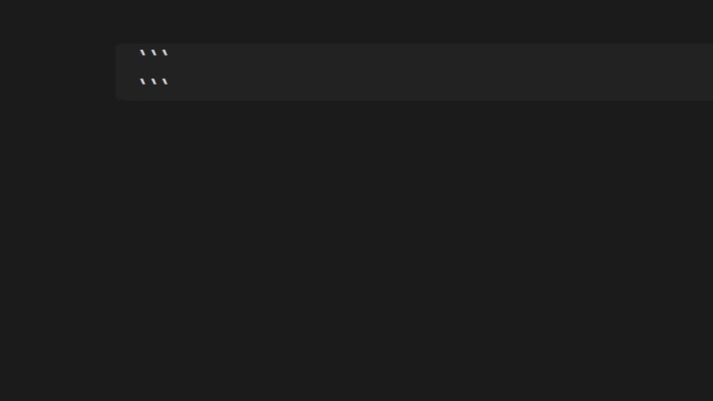

# DnD Wiki

DnD Wiki displays spells, feats, magic items, and other wiki content directly inside your notes.
The plugin includes source configurations for both the 2014/5e and 2024 rules.

## Features

- Display DnD entries as collapsible cards.
- Create complete or filtered lists of spells, weapons, feats, items and more.
- Display complete class pages, subclasses, and selected page sections.
- Get autocomplete for block types, names, and supported filters.
- Create experimental Markdown homebrew files in your vault.



## Basics

Every DnD Wiki block follows this pattern:

```text
dnd<version>-<content-type>
```

Two versions are configured by default:

- `5e` uses the DnD 5e source.
- `2024` uses the DnD 2024 source.

The content type determines what is displayed. Examples include `spell`, `spelllist`, `weapon`, `weaponlist`, `feat`, etc.


## Autocomplete

You do not need to remember block names, spell names, or filter options. Start by typing:

````text
```dnd
````

DnD Wiki suggests a version such as `5e` or `2024`, followed by available content types. For example, typing ` ```dnd5e-` suggests `spell`, `spelllist`, `feat`, `magicitem`, and the other registered types.

Inside a block, autocomplete suggests known card names and supported directives.

## DnD features

Individual blocks display named entries. List blocks load a collection and apply filters.

| Feature | Blocks |
|---|---|
| Spells | `spell`, `spelllist` |
| Feats | `feat`, `featlist` |
| Magic items | `magicitem`, `magicitemlist` |
| Weapons | `weapon`, `weaponlist` |
| Backgrounds | `background`, `backgroundlist` |
| Lineages | `lineage`, `lineagelist` |
| Class pages | `classinfo` |
| Custom wiki pages | `custom` |

For example, an individual block renders named entries:

````markdown
```dnd5e-spell
Fireball
Mage Hand
```
````

A list block renders matching entries and can apply filters:

````markdown
```dnd5e-spelllist
level: 3
class: Wizard
school: Evocation
```
````

<details>
<summary><h3 style="display: inline;">Spell</h3></summary>

The `spell` block displays one or more spells by name or identifier, one per line.

````markdown
```dnd5e-spell
Fireball
Mage Hand
```
````

The `spelllist` block displays spells and supports these directives:

| Directive | Purpose |
|---|---|
| `level:` | Levels 0–9, comma-separated values, ranges, or `all` |
| `class:` | One or more classes |
| `school:` | One or more schools |
| `addspells:` | Add spells after filtering |
| `removespells:` | Remove spells from the result |
| `search:` | Search names and rendered content |
| `searchMode:` | Combine searches with `and` or `or` |
| `homebrew:` | Include, exclude, or show only homebrew entries |

Values within one `class:` or `school:` directive are alternatives. Different filter categories are combined. Repeated `search:` directives use `or` by default.

````markdown
```dnd5e-spelllist
level: 1-3
class: Wizard
school: Evocation
addspells: Healing Word
```
````

</details>

<details>
<summary><h3 style="display: inline;">Feat</h3></summary>

The `feat` block displays one or more feats by name or identifier, one per line.

````markdown
```dnd5e-feat
Alert
Lucky
```
````

The `featlist` block displays feats with `homebrew:`, `search:`, and `searchMode:` filters.

````markdown
```dnd5e-featlist
search: constitution
search: strength
searchMode: or
```
````

</details>

<details>
<summary><h3 style="display: inline;">Magic item</h3></summary>

The `magicitem` block displays one or more magic items by name or identifier, one per line.

````markdown
```dnd5e-magicitem
Bag of Holding
```
````

The `magicitemlist` block displays magic items with `level:`, `type:`, `attuned:`, `homebrew:`, `search:`, and `searchMode:` filters.

````markdown
```dnd5e-magicitemlist
level: Uncommon, Rare
type: Wondrous Item
attuned: required
search: teleport
```
````

</details>

<details>
<summary><h3 style="display: inline;">Weapon</h3></summary>

The `weapon` block displays one or more weapons as tables, one per line.

````markdown
```dnd2024-weapon
Longsword
Shortbow
```
````

The `weaponlist` block displays weapons with `type:`, `property:`, `homebrew:`, `search:`, and `searchMode:` filters. The 2024 source also supports `mastery:`, `showPropertyTable:`, and `showMasteryTable:`.

````markdown
```dnd2024-weaponlist
type: Martial Melee
property: Finesse
mastery: Vex
search: damage
```
````

</details>

<details>
<summary><h3 style="display: inline;">Background</h3></summary>

The `background` block displays one or more backgrounds by name or identifier, one per line.

````markdown
```dnd5e-background
Folk Hero
```
````

The `backgroundlist` block displays backgrounds with `homebrew:`, `search:`, and `searchMode:` filters.

````markdown
```dnd5e-backgroundlist
search: skills
```
````

</details>

<details>
<summary><h3 style="display: inline;">Lineage</h3></summary>

The `lineage` block displays one or more lineages by name or identifier. For the 2024 source, this represents species.

````markdown
```dnd2024-lineage
Elf
```
````

The `lineagelist` block displays lineages with `homebrew:`, `search:`, and `searchMode:` filters.

````markdown
```dnd2024-lineagelist
search: darkvision
```
````

</details>

<details>
<summary><h3 style="display: inline;">Class information</h3></summary>

Displays a class-related page or subclass. `class:` and the final `subinfo:` value are combined into `{baseUrl}/{class}:{subinfo}`.

Use `section:` to display one matching heading, or `sectionFrom:` to display that heading and following headings at the same level.

````markdown
```dnd2024-classinfo
class: Warlock
subinfo: Eldritch Invocation
sectionFrom: Agonizing Blast
```
````

</details>

<details>
<summary><h3 style="display: inline;">Custom wiki page</h3></summary>

Loads content that does not have a dedicated DnD Wiki content type. It can use `section:` and `sectionFrom:` to select part of the page.

````markdown
```dnd2024-custom
source: equipment:weapon
section: Mastery Properties
```
````

The `source:` value is appended directly to the selected base URL. Autocomplete suggests directive names, but not custom page paths or section names.

</details>

## Custom Homebrew

Create a homebrew file from **Settings → DnD Wiki → Homebrew templates → Add homebrew file**, or run the **Create homebrew file** command. Each homebrew category includes a starter template you can copy and customize.

If you create or edit a homebrew file manually, run the **Update homebrew content** command or select **Refresh homebrew** in the settings to update the plugin's homebrew cache.

You can exclude homebrew files and folders by configuring ignored prefixes in the homebrew settings. The default prefix is `_`, so template files and folders beginning with `_` are ignored automatically.

## Data and privacy

DnD Wiki does not collect telemetry, analytics, usage statistics, vault filenames, or note contents.

The plugin sends network requests only to its configured D&D wiki sources. It downloads the index and content pages needed to render cards and lists.

Downloaded content is cached only in memory. It is not saved permanently and is discarded when Obsidian or the plugin restarts. The plugin permanently stores only its settings, such as configured source URLs. Homebrew files remain ordinary files in the user's vault.

## Legal notice

DnD Wiki is an unofficial fan-made project. It is not approved, sponsored, or endorsed by Wizards of the Coast.

Dungeons & Dragons, DnD, Wizards of the Coast, and related names, trademarks, rules, artwork, characters, and game materials belong to their respective rights holders, including Wizards of the Coast LLC where applicable. This project does not claim ownership of that material.

The [BSD Zero Clause License](LICENSE) applies only to the plugin's source code. It does not grant rights to remote wiki content, DnD material, user-created cards, or other third-party content.

DnD Wiki retrieves and displays content from sources selected by the user. Source operators and users are responsible for ensuring that their content and use comply with applicable copyright, trademark, licensing, and website terms.

See the official [Wizards of the Coast Fan Content Policy](https://company.wizards.com/en/legal/fancontentpolicy) and [DnD System Reference Document licensing information](https://www.dndbeyond.com/srd).

## Project note

This project is mostly for fun. I created it to make writing my DM and player notes in Obsidian easier and to reference DnD rules directly from those notes.

DnD Wiki depends on the structure of external wikis. If those wikis change, some features may stop working. I intend to fix issues when they arise.

Also sometimes the wiki pages may be temporarily unavailable, so the plugin won't be able to display content during those times.
